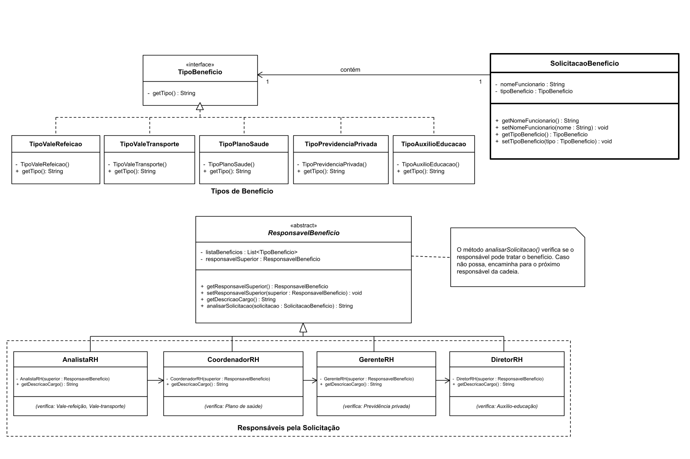

# Padrão de Projeto: Chain of Responsibility (Sistema de RH)

Projeto em Java exemplificando a aplicação do padrão comportamental **Chain of Responsibility** no contexto de um sistema de benefícios de Recursos Humanos para a disciplina DCC078-2026.3-A - Aspectos Avançados em Engenharia de Software.

## Diagrama de Classes UML

## Padrão Utilizado

O padrão **Chain of Responsibility** é utilizado para encaminhar solicitações de benefícios entre diferentes responsáveis do setor de Recursos Humanos. Cada responsável verifica se pode tratar o tipo de benefício solicitado. Caso não possa, encaminha a solicitação ao próximo responsável da cadeia.

Os responsáveis são representados pelas classes `AnalistaRH`, `CoordenadorRH`, `GerenteRH` e `DiretorRH`, que herdam da classe abstrata `ResponsavelBeneficio`.

## Estrutura

- `SolicitacaoBeneficio`: representa a solicitação de benefício, contendo o nome do funcionário e o tipo solicitado.
- `TipoBeneficio`: interface que identifica os tipos de benefício.
- `TipoValeRefeicao`, `TipoValeTransporte`, `TipoPlanoSaude`, `TipoPrevidenciaPrivada` e `TipoAuxilioEducacao`: representam os tipos de benefício disponíveis.
- `ResponsavelBeneficio`: classe abstrata que define o comportamento de análise e encaminhamento das solicitações.
- `AnalistaRH`: responsável por solicitações de vale-refeição e vale-transporte.
- `CoordenadorRH`: responsável por solicitações de plano de saúde.
- `GerenteRH`: responsável por solicitações de previdência privada.
- `DiretorRH`: responsável por solicitações de auxílio-educação.
- `SolicitacaoBeneficioTest`: classe de testes para verificar o encaminhamento das solicitações pela cadeia.

## Testes

Os testes verificam:

- encaminhamento de vale-refeição para o Analista de RH;
- encaminhamento de vale-transporte para o Analista de RH;
- encaminhamento de plano de saúde para o Coordenador de RH;
- encaminhamento de previdência privada para o Gerente de RH;
- encaminhamento de auxílio-educação para o Diretor de RH;
- retorno de ausência de aprovação quando nenhum responsável trata a solicitação.

Ao todo, são **6 testes automatizados**, utilizando JUnit 5.
